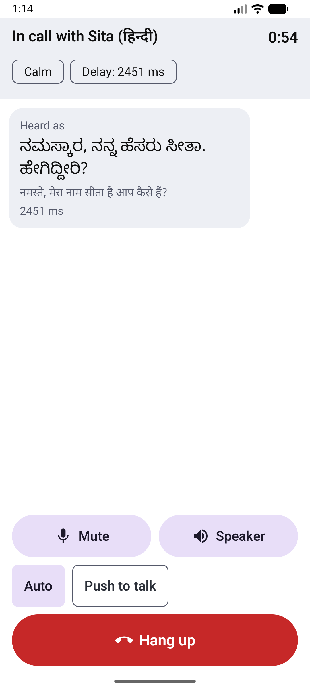
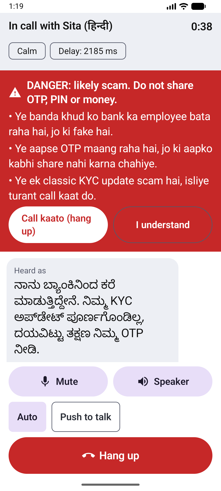
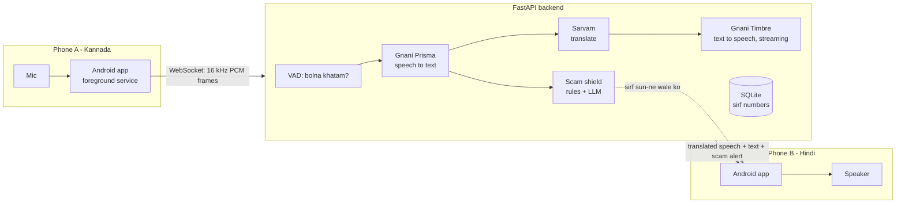

# KahoSuno

> **Kaho apni boli mein. Suno apni boli mein.**

**Voice powered by Gnani Prisma (STT) and Timbre (TTS).**

Do log phone call par apni-apni bhasha mein baat karte hain, aur app beech mein **live translate** karti hai.
Pehli language pair: **Kannada (kn-IN) <-> Hindi (hi-IN)**. Saath mein ek **scam shield**: OTP, KYC, "digital arrest" jaise
fraud pakad kar sun-ne wale ko chetavni deta hai.

Kiske liye: pardes mein kaam karne wale mazdoor, unke parivar, aur buzurg log. Isliye bade akshar, bade buttons,
aur Hinglish chetavni.

> Gnani AI "Great Indian AI Internship Challenge" ke liye banaya gaya. Pitch notes: [docs/pitch-notes.md](docs/pitch-notes.md).
> Kya check ho chuka hai aur kya nahi: [docs/checklist.md](docs/checklist.md).




## Kaise kaam karta hai



| Step | Kaun | Kyun |
|---|---|---|
| Bolna khatam hua? | webrtcvad (server par) | Push-to-talk ki zaroorat nahi |
| Speech to text | **Gnani Prisma** `api.vachana.ai/stt/v3` | Kannada + Hindi dono support |
| Translation | Sarvam `sarvam-translate:v1` | Benchmark mein `mayura:v1` se tez, aur sirf target language deta hai |
| Text to speech | **Gnani Timbre v2.5** (SSE streaming) | Audio pura banne se pehle chalna shuru |
| Scam shield | Regex rules + Sarvam `sarvam-105b` | Rules tez, LLM naye tareeke pakadta hai |

Har stage ek provider interface ke peeche hai ([backend/app/services/providers.py](backend/app/services/providers.py)). Vendor
config se badal sakte hain: `STT_PROVIDER`, `TTS_PROVIDER`, `TRANSLATE_PROVIDER`.

**Speed** (asli API, synthetic awaaz, bolna khatam hone se pehli awaaz tak): lagbhag **1.7 - 2.0 second**.
Isme se ~1.1 s translation leti hai. Poori table: [docs/benchmarks.md](docs/benchmarks.md).

## Folder

```
backend/    Python 3.11, FastAPI     app/{api,core,models,services}, tests/, Dockerfile
android/    Kotlin, Jetpack Compose  app/src/{main,test}
docs/       protocol.md, benchmarks.md, checklist.md, pitch-notes.md, screenshots/
docker-compose.yml   render.yaml   .github/workflows/ci.yml
```

## Chalane ke tareeke

### 1. Backend (local)

```bash
cd backend
py -3.13 -m venv .venv            # Python 3.11+ chalega
.venv\Scripts\pip install -e ".[dev]"
copy .env.example .env             # phir .env mein GNANI_API_KEY, SARVAM_API_KEY, JWT_SECRET bharein
.venv\Scripts\uvicorn app.main:app --port 8000
```

`JWT_SECRET` ke liye random string banayein: `python -c "import secrets; print(secrets.token_urlsafe(48))"`.
Production mein (`APP_ENV=production`) 32 se kam akshar ka secret ho to server **chalu hi nahi hota**.

Tests: `.venv\Scripts\pytest` (198 tests, API key nahi chahiye) aur `ruff check .` / `mypy app`.
Asli API se check: `PYTHONPATH=. python scripts/smoke.py pipeline kn-IN hi-IN`.

### 2. Docker

```bash
docker compose up --build         # backend/.env ki zaroorat hai
curl http://localhost:8000/health
```

Container normal user se chalta hai, healthcheck ke saath. Call records `call-data` volume mein (sirf numbers).

### 3. Android app

1. Android Studio mein `android/` folder kholein (pehli baar Gradle sync SDK 35 download karega).
   **Gradle JDK 17 ya 21 chuniye** (jlink wala). Studio ka JDK 25 is project ke Gradle 8.10 ke saath nahi chalta.
2. Emulator banayein. Awaaz bolne ke liye: Extended controls > Microphone > *Virtual microphone uses host audio input*.
3. Run karein. Server address default `http://10.0.2.2:8000` hai (emulator se aapke PC ka localhost).
   Asli phone par Settings mein PC ka LAN IP ya Render ka `https://...onrender.com` daalein.
4. Command line se: `cd android && gradlew.bat assembleDebug test` (`android/local.properties` mein
   `sdk.dir=C:/Users/<naam>/AppData/Local/Android/Sdk` chahiye, **forward slash** ke saath).

### 4. Render (free tier) par deploy

1. Repo GitHub par daalein, Render mein **New > Blueprint** chuniye (`render.yaml` apne aap padh leta hai).
2. `GNANI_API_KEY` aur `SARVAM_API_KEY` Render dashboard mein daalein. `JWT_SECRET` Render khud banata hai.
3. App ki Settings mein server address `https://<aapka-naam>.onrender.com` rakhein (wss apne aap).

Free tier ki baatein: ~15 min khali rehne par server so jaata hai, pehli request ko ~1 minute lagta hai
(demo se pehle `/health` khol lein). Har deploy par disk saaf hota hai, to history reset ho jaati hai.

## Demo (2 minute)

1. Backend chalayein. Phone/emulator A: naam daalein, bhasha **ಕನ್ನಡ**, consent tick, **Start call**. Screen par 6 ank ka code aayega.
2. Phone/emulator B: bhasha **हिन्दी**, **Join with code**, wahi code, consent, **Join call**.
3. A Kannada mein bole. B ko **Hindi mein awaaz** aur bade akshar mein text milta hai, saath mein delay (~2 s) aur tone chip.
4. B bole: *"Main bank se bol raha hoon, aapka KYC update nahi hua, turant OTP bataiye."* A ko **laal chetavni** milti hai,
   vibration ke saath. **Call kaato** dabane se call turant kat jaati hai.
5. **History** mein dono calls dikhti hain: sirf time, bhasha, delay, scam level. Awaaz ya text nahi.

**Akele test karna ho** (doosra phone nahi hai)? `demo_peer.py` doosre insaan ka kaam karta hai: room code do, phir jo
likhoge wo Hindi mein bola jayega aur app mein translate hokar dikhega:

```bash
cd backend
PYTHONPATH=. .venv\Scripts\python scripts\demo_peer.py 123456      # /greet  /family  /scam  /bye, ya kuch bhi likhein
```

## Settings (backend `.env`)

| Variable | Matlab | Default |
|---|---|---|
| `GNANI_API_KEY`, `SARVAM_API_KEY` | API keys | (zaroori) |
| `JWT_SECRET` | join token ka secret | (zaroori; production mein 32+ akshar) |
| `APP_ENV` | `production` = safety checks on | `development` |
| `STT_PROVIDER` / `TTS_PROVIDER` | `gnani` ya `sarvam` | `gnani` |
| `TRANSLATE_PROVIDER` | `sarvam` ya `indictrans2` (stub) | `sarvam` |
| `SCAM_ENABLED` / `SCAM_LLM_ENABLED` | shield / LLM layer on-off. LLM band to sirf rules chalte hain | `true` |
| `MAX_ROOMS` | ek saath kitne rooms (memory bachane ke liye) | `200` |
| `TRANSCRIPT_RETENTION_DAYS` | opt-in transcript kitne din rakhe | `7` |

## Privacy (DPDP ke hisaab se)

- **Awaaz kabhi save nahi hoti.** Sirf memory mein rehti hai jab tak translate ho.
- Call ke baad sirf ek row: time, bhasha, utterances ki ginti, delay, errors, sabse upar scam level.
  **Naam, phone number, IP kuch nahi.**
- **Transcript sirf opt-in par**, aur sirf usi insaan ke bole hue ka. Android app ise kabhi on nahi karta. 7 din baad delete.
- Join karne ke liye **consent zaroori** hai (app aur server dono check karte hain).
- Logs mein na bola hua text aata hai, na join token (`token=<redacted>`). Dono ke tests hain.

## Security

Join token JWT hai (1 ghanta, reconnect ke liye), alag-alag room ka token doosre room mein nahi chalta.
Rate limits per IP (rooms aur websocket dono), room cap, audio frame 16 KB se bada nahi, bolne ki length 25 s tak,
websocket message size 64 KB, security headers, container non-root. Protocol: [docs/protocol.md](docs/protocol.md).

## Abhi ki kamiyan (sach-sach)

- Asli phone par aur **asli awaaz** (shor, accent) par test nahi hua. Sab kuch synthetic awaaz aur emulator par check hua hai.
- Emulator mein **bolke** nahi dekha aur translated awaaz **sun** nahi sakte the; sirf chalna shuru hota dikha.
- Scam rules haath se likhe aur synthetic sentences par test hue; asli scam call transcripts par nahi.
- Hindi/Kannada UI strings kisi native speaker ne check nahi kiye.
- Render par deploy aur GitHub Actions abhi chalaye nahi gaye.
- Tone preservation (Phase 5) abhi nahi bana.

## Roadmap

- Tone preservation (awaaz ka bhaav translated awaaz mein)
- **Odia (od-IN)**: Gnani STT abhi Odia support nahi karta; jab kare tab pair add hogi
- Gnani realtime STT/TTS WebSocket, aur self-hosted IndicTrans2 (translation tez karne ke liye)
- Server ke error messages ko Hindi/Kannada mein dikhana
- Asli users ke saath test aur scam rules ko asli transcripts par tune karna
